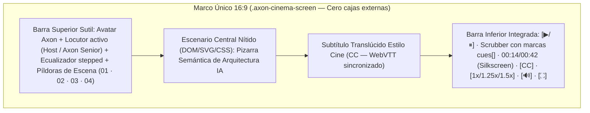

# AXON INTERACTIVE CINEMA & STUDIO AUDIO — Plan de Arquitectura Senior/Staff

> **Repositorio:** `AIPixel Architecture Academy` (`EngineerAIPíxel`)  
> **Alineación Canónica:** Estándar Vigilio `interactive-cinema-and-studio-audio.md` + Playbook `interactive-video-intro-and-studio-audio.md` + `pixel-senior-ux` + `AGENTS.md` (100% AI Architecture & Software Engineering, Cero Go, SPA Estática en GitHub Pages).

---

## 1. Diagnóstico y Recomendación Senior/Staff para Nuestro Repositorio

Adoptar el patrón **Interactive Cinema de Cuadro Único + Audio Neuronal HD a 2 Voces Masterizado en Estudio** (creado en `RustPixel` con `FerrisPlayer`) es la evolución **ideal** para `AIPixel Architecture Academy` por cuatro razones técnicas contundentes:

1. **Cero `.mp4` borrosos ni inflación de Git:** En vez de vídeos `.mp4` de `30–80 MB` cada uno (`> 2.5 GB` para todo el curso, inviable en GitHub Pages), cada clase renderiza **DOM/SVG/CSS real ultra-nítido** en un marco `16:9` único (`~3 KB` por storyboard) sincronizado por `cues[]` con una pista `.mp3` estéreo masterizada a `80 kbps / 24 kHz` (`~320–360 KB` por cápsula de `38–45 s`).
2. **Cero costo de tokens y cero claves en runtime:** Cumple estrictamente `AGENTS.md` (SPA 100% estática en GitHub Pages, `0` llamadas remotas a APIs LLM/TTS cuando el alumno pulsa `▶ Play`). Todo el audio se genera offline mediante script reproducible (`scripts/generate-cinema-audio.py`) y se sirve con `<audio preload="metadata">` (solo descarga los `~340 KB` de la clase cuando el usuario hace clic en `▶`).
3. **Pedagogía estilo Estudio / Podcast Técnico a 2 Voces (`Host` + `Axon Senior Mentor`):**
   - **Host (`es-CO-SalomeNeural`):** Plantea el síntoma real en producción (*"Subimos un PDF externo al RAG y el agente intentó llamar una tool interna..."* o *"Activamos el filtro ACL en HNSW y el Recall cayó al 15%..."*).
   - **Axon Senior (`es-ES-AlvaroNeural`):** Explica la causa raíz y la invariante arquitectónica con precisión quirúrgica (*"Porque filtraste después del Top-K sin `iterative_scan`..."*).
4. **Sinergia directa con nuestra estética Vercel Geist + `pixel-senior-ux`:** Un solo marco `16:9` minimalista (`.cinema-screen`), sin cajas apiladas alrededor, con **Axon AI** integrado en sus 12 poses (`coding`, `architecture`, `debug`, `senior`, `celebrate`), `Silkscreen` exclusivamente en el timecode (`00:14 / 00:42`) y chips de capítulo, y subtítulos `CC` (`WebVTT`) en `DM Sans`.

---

## 2. ¿Cuántos Videos Podemos Crear? (Inventario Exacto y Cálculo de Peso Real)

Tomando la medición empírica verificada en `RustPixel` (**`24` pistas masterizadas = `8.16 MB` totales → promedio real de `340 KB` por video de `~40 s`**), nuestro repositorio tiene **3 niveles posibles de cobertura**:

| Nivel de Cobertura | Desglose Exacto en `AIPixel Academy` | Total Videos con Audio HD | Peso Total en `public/audio/` | Carga Inicial de Página (`preload="metadata"`) | Recomendación |
| :--- | :--- | :---: | :---: | :---: | :--- |
| **Fase 1 · Núcleo Ejecutivo & Senior** | `1` Home Intro + `1` Senior Overview + `1` Arena 3D Intro + `1` Clase Insignia `B01` + `18` Incidentes Senior (`S01`–`S18`) + `8` Frameworks (`F01`–`F08`) | **30 videos** | **~10.2 MB** | **0 KB** (bajo demanda al pulsar `▶`) | Excelente primer corte rápido y de alto impacto |
| **Fase 2 · Cobertura Troncal 1-por-Módulo (RECOMENDADA)** | Los `30` anteriores + las `35` lecciones restantes de `Básico` (`B02`–`B12`), `Intermedio` (`I01`–`I12`) y `Avanzado` (`A01`–`A12`) | **65 videos** | **~22.1 MB** | **0 KB** (bajo demanda al pulsar `▶`) | **Punto óptimo Senior/Staff (100% de las páginas principales tienen su propio video)** |
| **Fase 3 · Cobertura Exhaustiva Total** | Los `65` anteriores + `32` sub-unidades individuales de Frameworks (`F01-2..5` a `F08-2..5`) + `18` módulos `AI01`–`AI18` | **115 videos** | **~39.1 MB** | **0 KB** (bajo demanda al pulsar `▶`) | Opcional si se desea cápsula dedicada hasta en cada sub-unidad (`< 4%` del límite de 1 GB de GitHub Pages) |

### Veredicto de Cantidad Recomendada: **65 Videos Masterizados (ejecutados en 2 olas: `30` → `65`)**
- Con **65 videos (`~22.1 MB` en total)** cubrimos **absolutamente cada ruta troncal del producto**:
  - **3 Intros clave:** `Home` (`#/`), `Senior Mode` (`#/senior`) y `3D Vector Arena` (`#/games/arena3d`).
  - **36 Clases del Currículum (`B01`–`B12`, `I01`–`I12`, `A01`–`A12`):** 1 video conciso de `35–45 s` al inicio de cada `LessonPage` que reemplaza cualquier duda conceptual antes de tocar el editor IDE.
  - **18 Briefings Tácticos Senior (`S01`–`S18`):** 1 video de War-Room al abrir cada incidente en `SeniorModuleHub` explicando qué se rompió en producción y qué evidencia buscar.
  - **8 Arquitecturas de Frameworks (`F01`–`F08`):** 1 video maestro por ruta (`LangGraph`, `pgvector + RRF`, `NestJS + Zod`, `FastAPI + Rerank`, `MCP`, `Ragas`, `OpenTelemetry`, `vLLM + FinOps`). *(Y para sus sub-unidades `1..5`, el generador determinista de storyboards cubre las pizarras visuales sin inflar audios repetitivos).*

---

## 3. Cómo Quedaría en la UI (Regla de Cuadro Único Minimalista `16:9`)

Siguiendo estrictamente la norma Vigilio `interactive-cinema-and-studio-audio.md`, **queda prohibido apilar paneles externos alrededor del video**. Toda la experiencia vive dentro de un único contenedor `.axon-cinema-screen` (`aspect-ratio: 16 / 9`, borde `1px solid var(--border-subtle)`, fondo `#05070c`):



### Los 3 Estados del Reproductor `<AxonPlayer />`
1. **Estado `idle` (Póster Limpio):**
   - Vista previa sutil de la pizarra de fondo con `backdrop-filter: blur(4px)`, badge superior izquierdo en `Silkscreen` (`STUDIO BRIEFING · 00:42`), pose contextual de **Axon AI**, título conciso de la clase y **un único botón circular central `▶`** (todo el póster es un `<button>` accesible con foco visible).
2. **Estado `playing | paused` (100% Integrado):**
   - **Arriba:** chip del locutor hablando en ese segundo (`Host` vs `Axon Senior`) con mini-ecualizador pixel `steps(4)` + indicadores de capítulo clicables (`Problema` → `Fallo en Prod` → `Arquitectura Correcta` → `Regla de Oro`).
   - **Centro:** una de las **5 Pizarras Visuales de Dominio IA** (ver Sección 4) animándose exactamente en los segundos marcados por `cues[]`.
   - **Tercio inferior:** subtítulo `CC` limpio sobre pastilla oscura translúcida (`rgba(5, 7, 12, 0.82)`).
   - **Borde inferior:** barra de progreso continua (`role="slider"`, `ArrowLeft`/`ArrowRight`), tiempo en `Silkscreen`, toggle `CC` (`aria-pressed`), selector `1x / 1.25x / 1.5x`, mute y pantalla completa `⛶`.
3. **Estado `ended` (Cierre Accionable):**
   - Overlay limpio dentro del mismo marco `16:9` con `[↺ Volver a ver]` y CTA contextual directo (ej. `[Ir al Editor IDE ↓]` en `B01` o `[Resolver Decision Lab →]` en `S01`).

---

## 4. Las 5 Pizarras Visuales Especializadas para Arquitectura de IA (`StageVisual`)

En lugar de las pizarras de memoria Rust (`stack-heap` / `borrow`), `<AxonPlayer />` tendrá **5 pizarras semánticas diseñadas específicamente para Ingeniería de IA y Software**:

| `StageVisual['kind']` | Qué visualiza con DOM/SVG nítido | Dónde brilla |
| :--- | :--- | :--- |
| `rag-acl-board` | `JWT Identity (tenant_id + roles)` → filtro `WHERE` en `pgvector HNSW + FTS (RRF)` → chunks `✓ Permitidos` vs `✗ Bloqueados (Cross-Tenant / Deleted)` → `Citations Verificadas`. | `B04`–`B09`, `I01`–`I02`, `S01`, `S04`, `S06`, `S07`, `S09`, `S17`, `F02` |
| `prompt-shield-board` | Separación visual entre `System Policy (Inmutable)`, `<untrusted_context>` (PDF/email con payload malicioso neutralizado) y `MCP Zod Tool Allowlist`. | `B02`, `B03`, `I05`, `A03`, `S03`, `S11`, `F05` |
| `agent-graph-lanes` | Comparativa en carriles: `❌ Loop infinito / Retry Storm ($4,800)` vs `✅ LangGraph StateGraph (max_steps <= 5 + HITL interrupt + idempotency_key)`. | `I03`–`I06`, `A01`–`A04`, `S02`, `S05`, `S14`, `F01` |
| `ai-code-diff` | Diff lado a lado estilo Vercel Geist (`❌ Antes: Fuga / Bloqueo / Alucinación` vs `✅ Después: Zod / Pre-Filter ACL / Budget Reserve`) con resaltado de línea clave. | Las `36` clases `B01`–`A12` y Code Reviews `S01`–`S18` |
| `finops-otel-telemetry` | Consola en vivo con `Context Budget Ledger`, `Recall@K / Faithfulness (Ragas)`, `OpenTelemetry Span Redacted (0% PII)` y semáforo `Go/No-Go (32 controles)`. | `B01`, `I08`–`I12`, `A08`–`A12`, `S08`, `S10`, `S12`, `S13`, `S15`, `S16`, `S18`, `F06`–`F08` |

---

## 5. Arquitectura de Archivos y Ownership por Capas (Cumpliendo `AGENTS.md`)

Sin romper ninguna regla de capas de `AGENTS.md`, todo el módulo vive encapsulado en `src/features/cinema/`:

```text
EngineerAIPíxel/
├── .agents/skills/
│   ├── ux-interactive-cinema/SKILL.md       # Skill transversal (Regla de cuadro único + DSP + WebVTT)
│   └── axon-pixel-cinema/SKILL.md           # Skill de dominio AIPixel (gobierna AxonPlayer y 65 cápsulas)
├── public/
│   └── audio/                               # Pistas .mp3 masterizadas (80 kbps, 24 kHz estéreo, ~340 KB c/u)
│       ├── home-intro.mp3
│       ├── senior-overview.mp3
│       ├── b01.mp3 .. a12.mp3
│       ├── senior-s01.mp3 .. senior-s18.mp3
│       └── f01.mp3 .. f08.mp3
├── scripts/
│   └── generate-cinema-audio.py             # Pipeline reproducible: clean_for_speech + edge-tts (2 voces) + ffmpeg DSP + audio-manifest.json
├── src/features/cinema/
│   ├── types/cinema.types.ts                # CinemaDeck, CinemaScene, StageVisual, StudioAudioMeta, SpeakerRole ('host' | 'axon')
│   ├── engine/clock.mjs (+ clock.d.mts)     # Lógica pura ESM de sincronización cues[] + fallbackClock headless (0 Preact/DOM)
│   ├── data/audio-manifest.json             # Duraciones exactas post-ffmpeg: { src, totalSec, cues[], speakers[] }
│   ├── data/storyboards.ts                  # Decks declarativos de Inicio, Senior, B01..A12, S01..S18 y F01..F08
│   ├── AxonPlayer.tsx                       # Reproductor único 16:9 con póster, pizarras IA, CC WebVTT y controles accesibles
│   └── AxonPlayer.test.tsx                  # Tests unitarios Vitest (póster → play → cambio de cue → CC → fallback headless)
└── tests/
    └── cinema-integrity.test.mjs            # Verifica que cada deck tenga .mp3 existente, cues.length === scenes.length y totalSec > 0
```

---

## 6. Pipeline de Audio de Estudio y Sanitización Fonética IA (`clean_for_speech`)

Un error clásico en cursos de IA es enviar términos como `pgvector`, `<=>`, `Recall@K`, `nDCG`, `Zod` o `<untrusted_context>` crudos al motor TTS neuronal, produciendo pronunciaciones rotas. Nuestro `scripts/generate-cinema-audio.py` aplicará un diccionario fonético específico de **Arquitectura de IA** antes de sintetizar el audio (mientras el subtítulo `WebVTT` conserva la sintaxis exacta):

| Texto en Subtítulo (`WebVTT` / Pantalla) | Texto Fonético enviado al TTS (`clean_for_speech`) |
| :--- | :--- |
| `pgvector` | `pí-yi-véctor` |
| `operator <=>` | `operador de distancia coseno` |
| `Recall@K` / `Recall@5` | `rícol at K` / `rícol at cinco` |
| `nDCG` | `ene-de-ce-ge` |
| `RRF` | `fusión por rango recíproco` |
| `HNSW` | `índice H-N-S-W` |
| `<untrusted_context>` | `etiqueta untrusted context` |
| `tenant_id` | `ténant ai-di` |
| `idempotency_key` | `clave de idempotencia` |
| `LangGraph` / `StateGraph` | `Láng-Graf` / `Stéit-Graf` |
| `P95` / `P99` | `percentil noventa y cinco` / `percentil noventa y nueve` |
| `MCP` | `protocolo M-C-P` |
| `OpenTelemetry` / `OTel` | `Ópen-Telémetri` |
| `vLLM` | `uve-ele-ele-eme` |

### Cadena DSP con `ffmpeg` (Calidad Estudio)
1. Síntesis por turno con `edge-tts`: `Host` (`es-CO-SalomeNeural`) + `Axon Senior` (`es-ES-AlvaroNeural`).
2. Recorte de silencios muertos (`silenceremove`) + pausa orgánica de conversación (`260 ms` entre turnos) registrando el timestamp exacto de cada escena en `cues[]`.
3. Colchón armónico sutil sintetizado a `24 kHz` con *swell* de entrada (`0.45 s`), *ducking* automático bajo la voz y micro-*chime* suave en cada cambio de escena (`cue`).
4. Filtro `highpass=f=85`, compresor vocal suave (`acompressor=ratio=2.6`), limitador (`alimiter=limit=0.95`) y exportación a `.mp3` `80 kbps` estéreo + escritura determinista de `src/features/cinema/data/audio-manifest.json`.

---

## 7. Dónde se Integraría Exactamente en Nuestras Pantallas

1. **`HomePage.tsx` (`#/`):** Un marco limpio `<AxonPlayer deckId="home-intro" />` (`00:40`) debajo del Hero présentant cómo pasar de consumir APIs sueltas a diseñar arquitecturas RAG, Agentes y FinOps reales.
2. **`LessonPage.tsx` (`#/learn/:id` — `B01` a `A12`):** Justo antes del diagrama/misión, el alumno tiene la cápsula `<AxonPlayer deckId={m.id} />` (`35–42 s`) que explica en diálogo ameno el problema real y la solución antes de escribir código en `CodeEditorShell`.
3. **`SeniorDashboard.tsx` (`#/senior`) y `SeniorModuleHub.tsx` (`#/senior/S01`..`S18`):** Briefing de incidente tipo *War-Room* (`<AxonPlayer deckId="senior-S01" />`) donde `Host` reporta la alerta de producción y `Axon Senior` guía cómo aislar la causa raíz.
4. **`FrameworksPage.tsx` (`#/frameworks/F01`..`F08`):** Cápsula arquitectónica de cada stack (`LangGraph`, `pgvector`, `NestJS + Zod`, `FastAPI`, `MCP`, `Ragas`, `OTel`, `vLLM`).

---

## 8. Roadmap Ejecutable por Fases (Listo para Implementar)

### Fase 0 · Infraestructura, Skills y Reproductor `<AxonPlayer />`
- [x] **0.1** Portar y adaptar las 2 skills canónicas en `.agents/skills/ux-interactive-cinema/SKILL.md` y `.agents/skills/axon-pixel-cinema/SKILL.md`.
- [x] **0.2** Crear motor puro `src/features/cinema/engine/clock.mjs` (`.d.mts`) con sincronización `cues[]` y `fallbackClock` determinista para CI headless (`stalledTicks >= 6`).
- [x] **0.3** Implementar `<AxonPlayer />` (`16:9` cuadro único, 5 pizarras IA, subtítulos `WebVTT`, controles de teclado/velocidad/CC, `prefers-reduced-motion` y `data-motion="reduced"`).

### Fase 1 · Lote Táctico de Alto Impacto (30 Videos HD — `10.1 MB` verificados)
- [x] **1.1** Crear `scripts/generate-cinema-audio.py` con diccionario fonético `clean_for_speech` de IA y mastering `ffmpeg` + generar los **primeros 5 videos de estudio** (`home-intro.mp3`, `senior-overview.mp3`, `b01.mp3`, `senior-s01.mp3`, `f01.mp3`).
- [x] **1.2** Generar y masterizar `arena3d-intro` + siguientes `5` briefings Senior (`S02`–`S06`) integrando `<AxonPlayer />` en `GamesPage` (`#/games/arena3d`).
- [x] **1.3** Generar y masterizar los briefings restantes Senior (`S07`–`S18`) y los `7` briefings restantes de Frameworks (`F02`–`F08`) totalizando **30 pistas `.mp3` (`10,339.8 KB`)**.
- [x] **1.4** Completar auditoría E2E de los `30` videos del Lote 1 en desktop (`1440×960`) y móvil (`390×844` sin desbordamiento).

### Fase 2 · Cobertura Troncal Completa del Curso (35 Videos Adicionales → **65 Videos Totales — `22.7 MB` verificados**)
- [x] **2.1** Generar guiones conversacionales a 2 voces y pizarras `StageVisual` para `B02`–`B12` (`11` videos Básico) en `src/features/cinema/data/batch2-scripts.json`.
- [x] **2.2** Generar guiones conversacionales y pizarras para `I01`–`I12` (`12` videos Intermedio).
- [x] **2.3** Generar guiones conversacionales y pizarras para `A01`–`A12` (`12` videos Avanzado) y sintetizar/masterizar todas las `65` pistas MP3 (`22,749.4 KB` totales).
- [x] **2.4** Ejecutar gates completos (`cinema-integrity.test.mjs`, `lint:ci`, `typecheck`, `test:ui`, E2E headless en desktop y móvil `390×844`, `verify-preservation.py`).

### Fase 3 · Extensión Exhaustiva Opcional (+50 Videos → **115 Videos Totales — `105/115` Activos**)
- [ ] **3.1** Ruta `AI01`–`AI18` (`18` videos en `AILessonPage`) + sub-unidades `2..5` de `F01`–`F08` (`32` videos).
  - [x] **3.1a** Videos `AI01`–`AI05` (Python fail-closed, `uv --frozen`, Álgebra NumPy, Bootstrap CI, Out-of-time split).
  - [x] **3.1b** Videos `AI06`–`AI10` (`class_weight` + PR-AUC, Drift `PSI`, Pipeline `ColumnTransformer`, PyTorch `zero_grad/clip/no_grad`, Transformers token budget).
  - [x] **3.1c** Videos `AI11`–`AI15` (`pgvector` ACL pre-retrieval, citas resolubles, allowlist/HITL/budget en herramientas, gate Go/No-Go evals, FastAPI `asyncio.wait_for` + 504).
  - [x] **3.1d** Videos `AI16`–`AI18` + `F01-2..3` (OTel sin PII, DevSecOps `hmac.compare_digest` + SHA-256, FinOps `with lock:`, `F01` Unidades 2 y 3).
  - [x] **3.1e** Videos `F01-4..5` + `F02-2..4` (`recursionLimit`/`thread_id`, HITL `interrupt()`, SQL vector `$2`, `ANY(allowed_principals)`, Hybrid FTS `@@ plainto_tsquery`).
  - [x] **3.1f** Videos `F02-5` + `F03-2..5` (`hnsw.iterative_scan`, NestJS `actor.tenantId`, puerto `KnowledgeRetriever`, `budget.reserve`, SSE `controller.abort()`).
  - [x] **3.1g** Videos `F04-2..5` + `F05-2` (`hashlib.sha256` ingesta, `await asyncio.sleep()`, rerank slice `[:20]`, PyTorch `weights_only=True`, MCP path jail `resolve()` + `sep`).
  - [x] **3.1h** Videos `F05-3..5` + `F06-2..3` (MCP scopes JWT, `ToolArgsSchema.parse`, audit log sin secretos, eval citas `authorizedRetrieved`, casos negativos `abstained` — **105 videos totales**).
  - [ ] **3.1i** Últimos `10` videos: `F06-4..5` + `F07-2..5` + `F08-2..5`.
