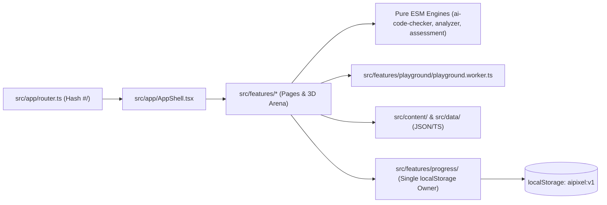

# AIPixel Architecture Academy


> **Static interactive AI Architecture & Software Engineering academy** featuring **Pixel Art identity (Axon mascot)**, **Vercel / Geist high-contrast palette**, **Three.js 3D Vector & RAG ACL Arena**, progressive **Basic → Intermediate → Advanced → Senior Mode** tracks, and **21+ Python native labs** — zero backend, ready for GitHub Pages.

---

## Table of Contents

1. [Overview & Features](#1-overview--features)
2. [Tech Stack](#2-tech-stack)
3. [Architecture Overview](#3-architecture-overview)
4. [Repository Structure](#4-repository-structure)
5. [Quick Start](#5-quick-start)
6. [Environment Variables](#6-environment-variables)
7. [Client Contracts & Storage](#7-client-contracts--storage)
8. [Testing Strategy](#8-testing-strategy)
9. [CI/CD Pipeline](#9-cicd-pipeline)
10. [Deployment (GitHub Pages)](#10-deployment-github-pages)
11. [Developer Checklist](#11-developer-checklist)
12. [Troubleshooting & Common Pitfalls](#12-troubleshooting--common-pitfalls)
13. [Contributing & License](#13-contributing--license)

---

## 1. Overview & Features

| Surface | Route | Capabilities |
| :--- | :--- | :--- |
| **Home & Tracks** | `#/` | Per-track progress rings, 6-language UI switcher (`es/en/ja/zh/pt/fr`), Vercel Geist Dark/Light & Senior Mode |
| **AI Learning Tracks** | `#/learn`, `#/lesson/:id` | `36` non-pre-solved AI Architecture + Software exercises (`B01–B12`, `I01–I12`, `A01–A12`) with deterministic multi-stack checker & Senior bridge notes |
| **Senior Mode (`S01–S18`)** | `#/senior` | `18` production AI architecture scenarios across `6` labs: Decision (`54` Qs), Evidence, Investigation, Operations, Code Review, Teaching Guides + Readiness Radar & Capstone |
| **AI Academy Hub** | `#/ai` | `18` AI lessons (`AI01–AI18`), `18` Senior AI cases (`SAI01–SAI18`), `4` deterministic simulators (RAG ACL, Token/FinOps, Eval Calibration, Agents) |
| **Playground Worker** | `#/playground` | Off-main-thread Web Worker static analyzer for `NestJS + Zod`, `LangGraph`, `PostgreSQL pgvector ACL` & `MCP + FinOps` (`14` antipattern rules) |
| **Frameworks & Games** | `#/frameworks`, `#/games` | `40` AI ecosystem units (`F01–F08`) + `50` interactive drills (`5` modes) + **Three.js 3D Vector & RAG ACL Arena** |
| **Progress & Settings** | `#/progress`, `#/settings` | Unified `aipixel:v1` state, `6` SVG badges, non-destructive migration from legacy keys, JSON backup import/export |
| **Python AI Native Labs** | `labs-ai-native/` | `18` Senior AI packages (`s01_rag_acl`..`s18_release_go_nogo`), `capstone_ai`, `rag_acl`, `ml_splits`, `finops_budget` (`25` `unittest` checks) |

> **Honesty & Execution Boundary:** Browser exercises, playgrounds, 3D arenas, and AI simulators run **deterministic pure-ESM rules and mathematical models** inside the browser/Web Worker. They never fake remote LLM inference or GPU execution in the browser. Native Python execution lives in `labs-ai-native/` (`python -m unittest`).

---

## 2. Tech Stack

| Layer | Technology | Version / Spec |
| :--- | :--- | :--- |
| UI Runtime | Preact + `@preact/signals` | `^10.27.0` / `^2.2.1` |
| Language | TypeScript (`strict: true`) | `^5.9.0` |
| 3D Visualization | `three` + `@types/three` | WebGL 3D Vector Arena with accessible fallback |
| Bundler | Vite | `^7.1.0` |
| Unit & Engine Tests | Node Test Runner (`node --test`) | Node `22+` |
| Component UI Tests | Vitest + `@testing-library/preact` + `jsdom` | `^4.1.x` |
| Browser E2E | `puppeteer-core` against `vite preview` | `^25.17.0` |
| Linter | `@biomejs/biome` (`lint:ci`) | `2.3.0` (`0` errors) |
| Native AI Labs | Python `unittest` (`labs-ai-native/`) | Python `3.12+` |
| Governance | `ORIGINAL_INTEGRITY.json` + `scripts/verify-preservation.py` | SHA-256 snapshot verification |

---

## 3. Architecture Overview



### Layer Ownership (`AGENTS.md`)

- **`src/app/`**: Root composition (`App.tsx`), `AppShell.tsx`, `router.ts`, `ErrorBoundary.tsx`, and `StaticPages.tsx`.
- **`src/shared/ui/`**: Agnostic UI primitives with `>= 2` real consumers (`Button`, `Card`, `Icon`, `Mascot`, `PageHeading`).
- **`src/features/<feature>/`**: Owns its pages, components, `types/`, `constants/`, and pure `engine/*.mjs` (with `.d.mts`) free of Preact/DOM/`localStorage`.
- **`src/features/progress/`**: **Single owner** of `localStorage` (`aipixel:v1`), sanitization, and non-destructive migration from `gopixel:v2`, `gopixel:v1`, and `vigilio:ai-academy:senior:v1`.
- **`src/content/` & `src/data/`**: Versioned AI curriculum separate from UI rendering.

---

## 4. Repository Structure

```text
.
├── .github/workflows/
│   ├── quality.yml                # SHA-pinned CI: lint, content, typecheck, tests, build, Python, preservation, E2E
│   └── deploy-pages.yml           # SHA-pinned GitHub Pages build & deploy with VITE_BASE_PATH
├── labs-ai-native/                # 18 Senior Python AI labs + capstone_ai + rag_acl + ml_splits + finops_budget
├── public/
│   ├── assets/
│   │   ├── mascot/                # Axon AI Pixel Mascot (12 poses including senior + 128px thumbs + favicon)
│   │   ├── backgrounds/           # Vercel Geist pixel landscapes (dark, light, senior)
│   │   ├── badges/                # 6 official SVG achievement badges
│   │   └── icons/                 # 29 pixel SVG icons
│   └── downloads/
│       └── ai-native-senior-labs.zip
├── scripts/
│   ├── audit-assets.mjs           # Content & asset verification
│   ├── test-master-e2e.mjs        # 8-gate headless browser E2E suite
│   ├── update-integrity.mjs       # Registers authorized edits in ORIGINAL_INTEGRITY.json
│   └── verify-preservation.py     # Verifies snapshot integrity
├── src/
│   ├── app/                       # AppShell, router, ErrorBoundary, StaticPages
│   ├── content/                   # Senior AI labs & AI Academy JSONs
│   ├── data/                      # 62 AI modules, 36 AI exercises, 8 AI frameworks curriculum
│   ├── features/
│   │   ├── ai/                    # AI Academy (#/ai) + pure engines
│   │   ├── editor/                # Pure ESM ai-code-checker.mjs
│   │   ├── frameworks/            # 40 AI framework units (F01-F08)
│   │   ├── games/                 # 5 AI drill modes (50 rounds) + Three.js 3D Vector Arena
│   │   ├── learning/              # Basic/Intermediate/Advanced AI learning paths & LessonPage
│   │   ├── playground/            # Web Worker AI/SQL/MCP static analyzer (#/playground)
│   │   ├── progress/              # Unified aipixel:v1 repository, signals & badges
│   │   ├── senior/                # Senior AI hub (#/senior S01-S18) & Readiness Radar
│   │   ├── settings/              # Preferences, i18n & backup/restore
│   │   └── welcome/               # HomePage
│   ├── shared/ui/                 # Shared UI primitives (Mascot, Icon, Card, Button, PageHeading)
│   └── styles/                    # app.css + vercel-palette.css (WCAG 2.2 AA semantic tokens)
├── tests/                         # Node test suite (engines, security, zero-go-leakage, WCAG tokens, BDD)
├── AGENTS.md                      # Binding AI-only architecture & verification rules
├── ORIGINAL_INTEGRITY.json        # Snapshot integrity manifest
├── ROADMAP_100_SENIOR_VIGILIO.md  # Full audit & completion checklist
├── package.json
└── vitest.config.ts
```

---

## 5. Quick Start

```bash
# 1. Install dependencies (Node 22+ required)
npm ci

# 2. Start local dev server
npm run dev

# 3. Build production bundle (dist/)
npm run build
```

Run native Python AI labs (`labs-ai-native/`):

```bash
python -m unittest discover -s labs-ai-native -t labs-ai-native -v
```

---

## 6. Environment Variables

| Variable | Default | Purpose |
| :--- | :--- | :--- |
| `VITE_BASE_PATH` | `/` | Public base path for GitHub Pages project sites (e.g., `/EngineerAIPixel/`) |
| `CHROME_PATH` | Auto-detected | Optional browser binary path for `scripts/test-master-e2e.mjs` |
| `E2E_BASE_URL` | `http://127.0.0.1:4173/` | Target URL for headless E2E execution |

---

## 7. Client Contracts & Storage

- **Routing:** Hash-based (`#/...`) for zero-config static hosting. All asset URLs resolve via `import.meta.env.BASE_URL`.
- **Unified Storage (`aipixel:v1`):**
  - Migrates legacy `gopixel:v2`, `gopixel:v1`, and `vigilio:ai-academy:senior:v1` payloads automatically on load.
  - All JSON imports and persisted payloads pass through strict schema sanitization (`sanitizePrefs`), stripping `__proto__`, `constructor`, and `prototype`, clamping bounds, recomputing lab scores, and guarding against `QuotaExceededError`.
- **Pure Engines (`engine/*.mjs`):** Deterministic evaluation (`ai-code-checker.mjs`, `analyzer.mjs`, `lesson-validator.mjs`, `assessment.mjs`, `ai-labs.mjs`, `ai-simulations.mjs`, `ai-readiness.mjs`) with accompanying `.d.mts` declarations.

---

## 8. Testing Strategy

| Suite | Command | Scope |
| :--- | :--- | :--- |
| Linter | `npm run lint:ci` | `@biomejs/biome` across `src`, `tests`, `scripts`, `vite.config.ts` (`0` errors) |
| TypeScript | `npm run typecheck` | Strict type checking across `src/` |
| Core, Curriculum & Zero-Go | `npm run check:content` | Node `--test` across all engines, security, WCAG tokens, 36 exercises, 40 frameworks, 50 game rounds & zero-Go leakage |
| AI Adversarial | `npm run test:ai` | Anti-spam, leakage, determinism & boundary checks |
| Security | `npm run test:security` | Prototype pollution, XSS/CSP/sanitization checks |
| UI Components | `npm run test:ui` | Vitest + Testing Library + jsdom (`ProgressPage`, `GamesPage` + 3D Arena, `LessonPage`, `AIAcademy`) |
| Python AI Labs | `python -m unittest discover -s labs-ai-native -t labs-ai-native -v` | `25` unit tests across 18 Senior packages + `capstone_ai` + `rag_acl` + `ml_splits` + `finops_budget` |
| Preservation | `python scripts/verify-preservation.py` | Verifies integrity manifest (`missing=0 unexpected_changes=0`) |
| End-to-End | `node scripts/test-master-e2e.mjs` | 8-gate headless Chromium/Brave suite against `vite preview` |

---

## 9. CI/CD Pipeline

- **`.github/workflows/quality.yml`**: Runs on `push` and `pull_request` to `main`. All third-party actions are pinned by full commit SHA with `persist-credentials: false` and `permissions: contents: read`. Executes `lint:ci`, `check:content`, `typecheck`, `test:ai`, `test:security`, `test:ui`, `build`, Python `unittest`, `verify-preservation.py`, `npm audit --audit-level=high`, and headless E2E.
- **`.github/workflows/deploy-pages.yml`**: Runs on `push` to `main` (or `workflow_dispatch`), verifies all gates, builds with `VITE_BASE_PATH=/${{ github.event.repository.name }}/`, and deploys `dist/` via `actions/deploy-pages`.

---

## 10. Deployment (GitHub Pages)

1. Push repository to GitHub with `main` as default branch.
2. In **Settings → Pages**, set **Source** to **GitHub Actions**.
3. `deploy-pages.yml` automatically sets `VITE_BASE_PATH=/<repo-name>/` and publishes `dist/`.

To test a subpath build locally:

```bash
VITE_BASE_PATH=/EngineerAIPixel/ npm run build
npx vite preview --port 4173
```

---

## 11. Developer Checklist

- [ ] Follow layer boundaries and 100% AI-only rules in [`AGENTS.md`](./AGENTS.md).
- [ ] Keep all `localStorage` reads/writes exclusively inside `src/features/progress/`.
- [ ] If editing any file tracked in `ORIGINAL_INTEGRITY.json`, run `node scripts/update-integrity.mjs <relative-path>`.
- [ ] Run `npm run lint:ci`, `npm run check:content`, `npm run typecheck`, `npm run test:ui`, `npm run build`, and `python scripts/verify-preservation.py` before pushing.
- [ ] Report verification gates honestly as `PASS | FAIL | NOT_RUN | BLOCKED`.

---

## 12. Troubleshooting & Common Pitfalls

- **Blank assets on GitHub Pages subpath:** Ensure `VITE_BASE_PATH=/<repo-name>/` is set at build time and asset paths use `import.meta.env.BASE_URL`.
- **Preservation check fails (`unexpected_changes`):** An archived baseline file was edited without updating `ORIGINAL_INTEGRITY.json`. Run `node scripts/update-integrity.mjs <path>`.
- **Headless E2E cannot find browser:** Set `CHROME_PATH` to your local Chrome/Brave/Edge executable before running `node scripts/test-master-e2e.mjs`.
- **WebGL disabled in headless/test environment:** `RagVectorArena3D.tsx` renders an accessible non-WebGL fallback automatically without throwing errors.

---

## 13. Contributing & License

- **Code & Original Mascot License:** [MIT License](./LICENSE) (Axon AI Mascot, pixel iconography, and Three.js 3D Arena are original project assets).
- **Architecture & Roadmap:** See [`AGENTS.md`](./AGENTS.md) and [`ROADMAP_100_SENIOR_VIGILIO.md`](./ROADMAP_100_SENIOR_VIGILIO.md).
